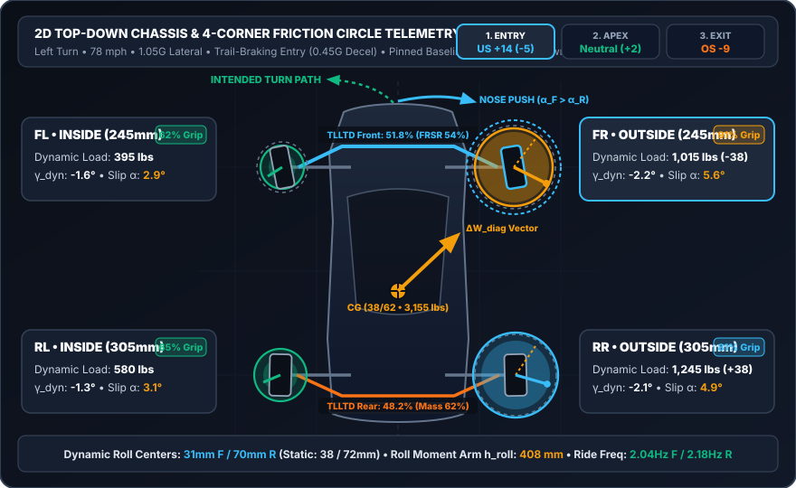
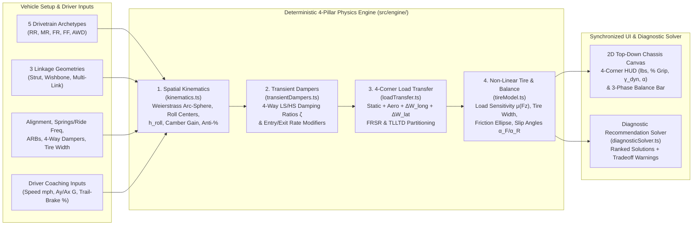
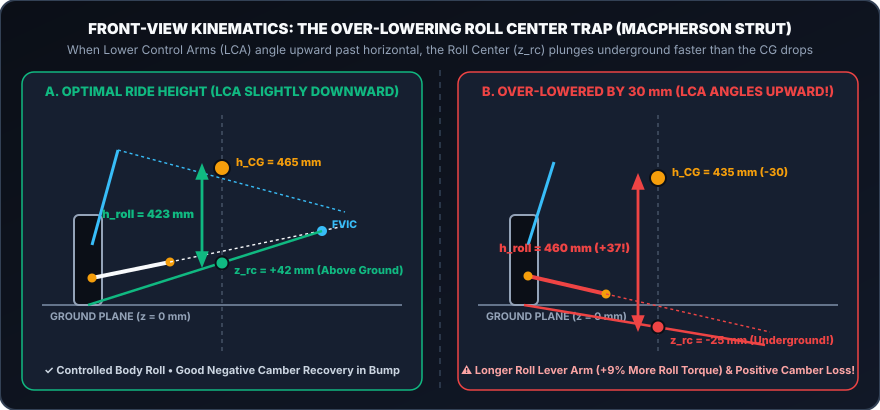
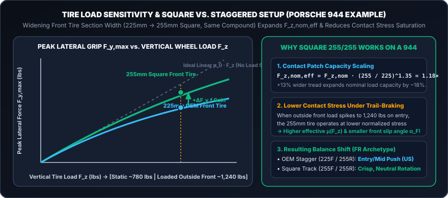

# Paddock Kinematics — Deterministic Track Suspension & Handling Visualizer

**Paddock Kinematics** is an offline-first, cross-platform mobile and web application (**iOS, Android, and Web** via **React Native + Expo SDK 57 + TypeScript**) built for high-performance driving instructors (such as **Porsche Club of America (PCA) HPDE** events), track-day drivers, and club racers.

Explaining multi-variable suspension kinematics, weight transfer, and tire saturation verbally in a noisy paddock is challenging. **Paddock Kinematics** bridges the gap between driver seat-of-the-pants feedback (*"the front pushes wide on turn-in"* or *"the rear steps out when trail-braking"*) and the underlying deterministic physics—allowing drivers and instructors to either ask symptom-driven questions or experiment with "what-if" setup changes on a live 2D chassis telemetry canvas.



---

## Table of Contents

1. [Core Capabilities & Paddock Workflows](#1-core-capabilities--paddock-workflows)
2. [System Architecture & Bidirectional Physics Pipeline](#2-system-architecture--bidirectional-physics-pipeline)
3. [Kinematic & Vehicle Dynamics Mathematical Examples](#3-kinematic--vehicle-dynamics-mathematical-examples)
   - [3.1 Spatial Double-Wishbone Camber Recovery (Weierstrass Arc-Sphere Solver)](#31-spatial-double-wishbone-camber-recovery-weierstrass-arc-sphere-solver)
   - [3.2 Wheel Rate, Series Tire Rate, Natural Ride Frequency ($f_n$), & Inverse Spring Solver](#32-wheel-rate-series-tire-rate-natural-ride-frequency-f_n--inverse-spring-solver)
   - [3.3 Roll Stiffness Ratio ($\text{FRSR}$), $\text{TLLTD}$, & Dynamic Roll Moment Arm ($h_{\text{roll}}$)](#33-roll-stiffness-ratio-textfrsr-texttlltd--dynamic-roll-moment-arm-h_textroll)
   - [3.4 The Over-Lowering Roll Center Geometry Trap (MacPherson Strut)](#34-the-over-lowering-roll-center-geometry-trap-macpherson-strut)
   - [3.5 Tire Load Sensitivity & Why a Square Setup Transforms a Porsche 944](#35-tire-load-sensitivity--why-a-square-setup-transforms-a-porsche-944)
   - [3.6 Longitudinal Anti-Dive ($\%AD$) & Anti-Squat ($\%AS$) Invariance Theorem](#36-longitudinal-anti-dive-ad--anti-squat-as-invariance-theorem)
4. [Supported Vehicle Archetypes & Baseline Presets](#4-supported-vehicle-archetypes--baseline-presets)
5. [Quick Start (Web, iOS/Android Expo Go, & Unit Tests)](#5-quick-start-web-iosandroid-expo-go--unit-tests)
6. [Repository Structure & Academic References](#6-repository-structure--academic-references)

---

## 1. Core Capabilities & Paddock Workflows

### Dual Synchronized Modes
- **🧭 Symptom / Question Wizard (`src/screens/SymptomWizardScreen.tsx`):**
  1. Select what the car is doing (**Understeer**, **Oversteer**, **Lazy Turn-In**, **Nervous Rear Under Braking**, **Poor Exit Traction**, or **Skittish Over Curbs & Bumps**).
  2. Select the corner phase (**1. Entry [Brake & Turn-In]**, **2. Mid-Corner [Apex]**, or **3. Exit [Throttle]**).
  3. Filter between **`⚡ Trackside Quick Tweaks`** (anti-roll bar blades, 4-way damper clicks, hot tire pressures, brake bias, aero balance, and driver trail-braking technique) and **`🔧 Alignment & Shop Setup`** (coil springs, target ride frequencies, static camber/toe/caster, tire section widths, ride height, roll centers, and LSD lock).
  4. Tap **`👁 Preview on 2D Car`** on any ranked solution card to overlay its exact effect on the 2D chassis against dashed baseline ghost rings before applying.
- **🎛 What-If Tuning Sandbox (`src/screens/SandboxTuningScreen.tsx`):**
  - Directly manipulate any suspension, alignment, tire, damper, drivetrain, or aerodynamic parameter and watch the 4-corner vertical loads ($\text{lbs}$), friction circle utilization ($\%$), dynamic camber ($\gamma_{\text{dyn}}$), slip angles ($\alpha_f, \alpha_r$), dynamic roll centers ($z_{\text{rc}}$), and Entry/Apex/Exit balance scores respond at 60 fps.

### Instructor Driver-Coaching Controls & Quick Presets
- **My Car Specs Quick Drawer (`src/components/visualizer/ArchetypeAndDriverBar.tsx`):**
  - **One-Tap Alignment Presets:** Choose **`OEM Road Default`** (safe factory understeer for drivers who don't know their alignment sheet), **`Maxed OEM Track`** (maximized factory eccentrics/strut slots), or **`Track Camber Plates`**, or dial in custom Front/Rear Camber and Toe.
  - **Tire Sizing Presets:** Toggle between **`OEM Tire Sizing (Staggered)`** and **`Square Track Setup`** (or dial in custom `195–345 mm` front/rear tire widths).
  - **Target Ride Frequency Presets:** Toggle between **`OEM Street (1.5 Hz)`**, **`Track Coilover (2.1 Hz)`**, and **`Full Race (2.7 Hz)`**, or drag the target Hz sliders to automatically back-solve the required spring rates in `lbs/in` and `N/mm`.
- **Instructor Coaching Sliders:** Demonstrate to students how **Trail-Brake Overlap %**, **Braking G**, **Throttle G**, **Driver Input Smoothness %**, and **Cornering Speed ($\text{mph}$)** shift weight transfer and tire saturation without touching a wrench.
- **☀ Paddock Daylight vs. 🌙 Dark Telemetry Theme:** One-tap high-contrast sunlight mode for outdoor pit-lane use.

---

## 2. System Architecture & Bidirectional Physics Pipeline

All calculations run **100% deterministically on-device** with zero network dependencies. Internal physics operate in strict SI units ($\text{N}, \text{mm}, \text{kg}, \text{rad}, \text{m/s}$) and convert at the presentation layer to US paddock units ($\text{lbs}, \text{mph}, \text{lbs/in}, \text{PSI}$) for instant glanceability.



---

## 3. Kinematic & Vehicle Dynamics Mathematical Examples

Below are worked mathematical examples illustrating the deterministic equations implemented in [`src/engine/`](src/engine/) and documented in [`docs/notebook_equations.md`](docs/notebook_equations.md) and the [Comprehensive Engineering Framework PDF](Comprehensive%20Engineering%20Framework%20for%20Race%20Car%20Suspension%20Kinematics,%20Dynamics,%20and%20Computational%20Modeling.pdf).

---

### 3.1 Spatial Double-Wishbone Camber Recovery (Weierstrass Arc-Sphere Solver)

In a 3D unequal-length double-wishbone suspension, as the lower control arm (LCA) rotates upward in jounce by angle $\theta_l$, the lower ball joint $\mathbf{p}_{\text{lbj}}(\theta_l)$ traces a circular arc about the inboard LCA pivot axis $\hat{\mathbf{u}}_l$. The upper ball joint $\mathbf{p}_{\text{ubj}}(\theta_u)$ traces its own arc of radius $R_u$ about the upper pivot axis $\hat{\mathbf{u}}_u$, constrained by the rigid upright kingpin distance $L_{\text{kp}}$:

$$\|\mathbf{p}_{\text{ubj}}(\theta_u) - \mathbf{p}_{\text{lbj}}(\theta_l)\|^2 = L_{\text{kp}}^2$$

Expanding the circular trajectory of the upper ball joint in terms of orthonormal basis vectors $(\mathbf{u}, \mathbf{v})$ in the upper arm's rotation plane yields the classical trigonometric constraint:

$$A \cos\theta_u + B \sin\theta_u + C = 0$$

Applying the **Weierstrass half-angle tangent substitution** $t = \tan(\theta_u / 2)$, where $\cos\theta_u = \frac{1 - t^2}{1 + t^2}$ and $\sin\theta_u = \frac{2t}{1 + t^2}$, transforms the 3D spatial linkage intersection into a closed-form quadratic equation implemented in [`solveDoubleWishboneArcSphere`](src/engine/kinematics.ts):

$$(C - A)t^2 + 2Bt + (C + A) = 0 \implies t = \frac{-B \pm \sqrt{A^2 + B^2 - C^2}}{C - A}, \quad \theta_u = 2\arctan(t)$$

#### Worked Example (Shorter Upper A-Arm vs. Longer Lower A-Arm)
- **Lower A-Arm Effective Radius:** $R_l = 360\text{ mm}$
- **Upper A-Arm Effective Radius:** $R_u = 240\text{ mm}$
- **Kingpin Upright Height:** $L_{\text{kp}} = 241.9\text{ mm}$
- When the wheel compresses $+25\text{ mm}$ in jounce ($\theta_l = +4.0^\circ$), because $R_u < R_l$, the shorter upper arm pulls the upper ball joint laterally **inward** further than the lower ball joint moves, tilting the top of the upright toward the chassis centerline:
  $$\Delta\gamma_{\text{bump}} = \arcsin\!\left(\frac{y_{\text{ubj}}(\theta_u) - y_{\text{lbj}}(\theta_l)}{L_{\text{kp}}}\right) - \gamma_{\text{static}} \approx -0.78^\circ \text{ (negative camber recovery)}$$
  This counteracts positive camber loss from body roll $\phi$, keeping the outside tire's contact patch flat against the asphalt at the apex.

---

### 3.2 Wheel Rate, Series Tire Rate, Natural Ride Frequency ($f_n$), & Inverse Spring Solver

A coil spring of linear stiffness $K_s$ mounted at a mechanical **Motion Ratio** $MR = \frac{\Delta x_{\text{spring}}}{\Delta z_{\text{wheel}}}$ and inclination angle $\theta_{\text{spring}}$ produces an effective vertical **Wheel Rate** ($K_w$) at the hub that scales with the **square** of the motion ratio:

$$K_w = K_s \cdot MR^2 \cdot \sin^2(\theta_{\text{spring}})$$

Because the pneumatic tire sidewall acts as an undamped vertical spring $K_t$ in series with the suspension wheel rate $K_w$, the combined vertical **Ride Rate** ($K_{\text{ride}}$) and **Sprung Mass Natural Ride Frequency** ($f_n$) are:

$$K_{\text{ride}} = \frac{K_w \cdot K_t}{K_w + K_t}, \qquad f_n = \frac{1}{2\pi}\sqrt{\frac{K_{\text{ride}} \times 1000}{m_{\text{corner,sprung}}}}$$

#### Worked Example (Rear-Engine `RR` Archetype Front vs. Rear Axle)
Suppose we have a $1,430\text{ kg}$ ($3,153\text{ lbs}$) rear-engine track car with a $38\% / 62\%$ static weight distribution and $88\%$ sprung mass fraction:
1. **Front Corner Sprung Mass:**
   $$m_{s,f} = 0.5 \times 1430\text{ kg} \times 0.38 \times 0.88 = 239.1\text{ kg}$$
2. **Front Spring Rate & Wheel Rate** ($K_{s,f} = 70\text{ N/mm} \approx 400\text{ lbs/in}$, $MR_f = 0.88$, $\theta_s = 82^\circ$):
   $$K_{w,f} = 70 \times (0.88)^2 \times \sin^2(82^\circ) = 53.15\text{ N/mm}$$
3. **Series Ride Rate** (with $245\text{ mm}$ front tire at $31.5\text{ PSI}$ giving $K_{t,f} \approx 235\text{ N/mm}$):
   $$K_{\text{ride},f} = \frac{53.15 \times 235}{53.15 + 235} = 43.35\text{ N/mm} = 43,350\text{ N/m}$$
4. **Front Natural Ride Frequency:**
   $$f_{n,f} = \frac{1}{2\pi}\sqrt{\frac{43,350}{239.1}} = \mathbf{2.14\text{ Hz}}$$

When you drag the **Target Ride Frequency** slider in the app, [`solveSpringRateForTargetRideFreqHz`](src/engine/kinematics.ts) inverts this exact system in closed form to solve for the required coil spring rate $K_s$:

$$K_{\text{ride,target}} = \frac{(2\pi f_n)^2 \, m_s}{1000}, \quad K_w = \frac{K_{\text{ride,target}} \cdot K_t}{K_t - K_{\text{ride,target}}}, \quad K_s = \frac{K_w}{MR^2 \sin^2(\theta_{\text{spring}})}$$

---

### 3.3 Roll Stiffness Ratio ($\text{FRSR}$), $\text{TLLTD}$, & Dynamic Roll Moment Arm ($h_{\text{roll}}$)

Each axle's total roll stiffness $K_{\phi,\text{axle}}$ ($\text{N}\cdot\text{m/rad}$) is the parallel sum of the ride springs (acting across track width $T$) and the tubular Anti-Roll Bar ($K_{\phi,\text{ARB}}$):

$$K_{\phi,\text{axle}} = \frac{1}{2} K_{\text{ride,axle}} \, T_{\text{axle}}^2 + K_{\phi,\text{ARB,axle}}, \qquad \text{FRSR} = \frac{K_{\phi,f}}{K_{\phi,f} + K_{\phi,r}}$$

During steady-state cornering at lateral acceleration $a_y$ (in $G$'s), the chassis experiences a roll moment driven by the **Roll Moment Arm** ($h_{\text{roll}}$)—the vertical distance between the Center of Gravity ($h_{\text{CG}}$) and the roll axis evaluated at the CG's longitudinal station:

$$h_{\text{roll}} = h_{\text{CG}} - \left[ z_{\text{rc},f}(1 - w_f) + z_{\text{rc},r} w_f \right]$$

The **Front Lateral Load Transfer** ($\Delta W_{\text{lat},f}$) is the sum of the **elastic roll moment** partitioned by $\text{FRSR}$ and the **direct geometric load transfer** acting through the front roll center height $z_{\text{rc},f}$:

$$\Delta W_{\text{lat},f} = \frac{W \cdot a_y}{T_f}\left[ \text{FRSR} \cdot h_{\text{roll}} + w_f \cdot z_{\text{rc},f} \right]$$

---

### 3.4 The Over-Lowering Roll Center Geometry Trap (MacPherson Strut)

A classic pitfall among track-day enthusiasts is slamming a MacPherson strut car on coilovers by $25\text{–}35\text{ mm}$ to "lower the Center of Gravity."



#### Worked Numerical Comparison
- **At Factory Track Ride Height ($\Delta z_{\text{ride}} = 0\text{ mm}$):**
  - The lower control arm slopes slightly downward toward the ball joint.
  - $h_{\text{CG}} = 465\text{ mm}$, $z_{\text{rc},f} = +38\text{ mm}$, $z_{\text{rc},r} = +72\text{ mm}$ (for $w_f = 0.38$):
    $$z_{\text{axis,CG}} = 38(0.62) + 72(0.38) = 50.9\text{ mm} \implies h_{\text{roll}} = 465 - 50.9 = \mathbf{414.1\text{ mm}}$$
- **Over-Lowered by $\Delta z_{\text{ride},f} = -30\text{ mm}$, $\Delta z_{\text{ride},r} = -20\text{ mm}$ without Roll-Center Correction Ball Joints:**
  - The chassis (and inboard LCA pivot) drops $30\text{ mm}$, forcing the LCA to angle **upward** toward the upright ball joint.
  - The Front View Instant Center (FVIC) plunges below ground, driving $z_{\text{rc},f}$ to **$-25\text{ mm}$** (subterranean) and $z_{\text{rc},r}$ to **$+36\text{ mm}$**:
    $$h_{\text{CG,new}} = 465 - 23.8 = 441.2\text{ mm}, \qquad z_{\text{axis,CG,new}} = (-25)(0.62) + 36(0.38) = -1.8\text{ mm}$$
    $$h_{\text{roll,new}} = 441.2 - (-1.8) = \mathbf{443.0\text{ mm}} \quad (\mathbf{+28.9\text{ mm longer lever arm!}})$$
- **Result:** Despite lowering the CG by $\sim 24\text{ mm}$, the roll moment arm $h_{\text{roll}}$ **increased by $7\%$**, causing *more* body roll, degraded negative camber recovery in bump, and severe mid-corner understeer! **Paddock Kinematics** automatically triggers an **Over-Lowering Geometry Trap Warning** whenever an axle crosses this kinematic threshold.

---

### 3.5 Tire Load Sensitivity & Why a Square Setup Transforms a Porsche 944

Unlike textbook Coulomb friction where $F_y = \mu_0 F_z$, real racing and track tires exhibit **Tire Load Sensitivity**: as vertical load $F_z$ increases, contact patch rubber saturates and the effective friction coefficient $\mu(F_z)$ decays non-linearly relative to the tire's nominal load capacity $F_{z,\text{nom}}$:

$$\mu(F_z) = \mu_{\text{peak}} \cdot \left(\frac{F_z}{F_{z,\text{nom,eff}}}\right)^{-k_{\text{load}}} \cdot \eta_{\text{stress}}\!\left(\frac{F_z}{F_{z,\text{nom,eff}}}\right)$$

Assuming an **identical tire compound** on all four corners, widening a tire's section width $W_{\text{tire}}$ enlarges the physical contact patch area and scales its effective nominal load capacity:

$$F_{z,\text{nom,eff}} = F_{z,\text{nom,base}} \cdot \left(\frac{W_{\text{tire}}}{W_{\text{oem}}}\right)^{1.35}$$



#### Worked Example: Modified Porsche 944 (`FR` Archetype: `225F / 255R` $\to$ `255F / 255R` Square)
1. **OEM Staggered Setup (`225 mm` Front / `255 mm` Rear):**
   - On a $52\%\text{ F} / 48\%\text{ R}$ front-engine RWD chassis under trail-braking and cornering at $1.05G$, the outside front tire (`FR` in a left turn) carries a heavy dynamic load of $F_{z,\text{FR}} \approx 5,320\text{ N}$ ($1,196\text{ lbs}$).
   - With the narrower $225\text{ mm}$ front tire, normalized contact stress $F_z / F_{z,\text{nom,eff}}$ is high ($1.48\times$ static), causing the front tire's friction coefficient $\mu_{\text{eff}}$ to drop and the front slip angle to climb to $\alpha_f = 5.4^\circ$ vs. $\alpha_r = 4.6^\circ$ (**Understeer / Entry & Apex Push**).
2. **Upgrading to a Square Setup (`255 mm` Front / `255 mm` Rear, Same Compound):**
   - Increasing front section width from $225\text{ mm}$ to $255\text{ mm}$ ($+13.3\%$) expands the front tire's nominal load capacity by:
     $$\left(\frac{255}{225}\right)^{1.35} = \mathbf{1.184\times} \quad (+18.4\% \text{ nominal load capacity})$$
   - At the exact same $1,196\text{ lbs}$ wheel load, the $255\text{ mm}$ front tire operates at $15.6\%$ lower normalized contact stress, increasing peak available front lateral grip $F_{y,\max}$, reducing outside front grip saturation by $\sim 7\%$, and dropping $\alpha_f$ from $5.4^\circ$ to $4.8^\circ$—transforming the car into a balanced, neutral-rotating track platform.

---

### 3.6 Longitudinal Anti-Dive ($\%AD$) & Anti-Squat ($\%AS$) Invariance Theorem

From the Side View Instant Center (SVIC) coordinates $(L_{\text{svic}}, h_{\text{svic}})$, front **Anti-Dive** ($\%AD$) and rear **Anti-Squat** ($\%AS$) are governed by:

$$\%AD = \text{BFD}_{\text{front}} \cdot \frac{h_{\text{svic},f}}{L_{\text{svic},f}} \cdot \frac{L}{h_{\text{CG}}} \times 100\%, \qquad \%AS_{\text{RWD}} = \frac{h_{\text{svic},r}}{L_{\text{svic},r}} \cdot \frac{L}{h_{\text{CG}}} \times 100\%$$

> **Crucial Engineering Invariance:** Changing Anti-Dive or Anti-Squat **never** alters total steady-state longitudinal weight transfer between the front and rear axles:
> $$\Delta W_{\text{long}} = \frac{W \cdot h_{\text{CG}} \cdot a_x}{g \cdot L}$$
> Because $W$, $h_{\text{CG}}$, $a_x$, and wheelbase $L$ are unchanged, a car braking at $1.0G$ transfers the **exact same number of pounds** to the front tires whether Anti-Dive is $0\%$ or $60\%$. Instead, $\%AD$ partitions that load between the **coil springs** ($1 - \%AD$) and the **rigid suspension control arms** ($\%AD$), reducing dynamic pitch angle $\theta_{\text{pitch}}$ at the cost of stiffer vertical wheel compliance over braking-zone bumps when $\%AD > 45\%$.

---

## 4. Supported Vehicle Archetypes & Baseline Presets

| Archetype ID | Layout & Weight Split | Representative Track Cars | OEM Tire Sizing | Square Track Preset | Default Linkage (F / R) |
| :--- | :--- | :--- | :--- | :--- | :--- |
| **`RR`** | Rear-Engine RWD (`38% F / 62% R`) | Porsche 911 Carrera / GT3 (996/997/991/992) | `245F / 305R mm` | `265F / 265R mm` | MacPherson Strut / Multi-Link |
| **`MR`** | Mid-Engine RWD (`45% F / 55% R`) | Porsche 718 Cayman GT4 / Boxster, Lotus Exige | `245F / 295R mm` | `265F / 265R mm` | MacPherson Strut / MacPherson Strut |
| **`FR`** | Front-Engine RWD (`52% F / 48% R`) | Porsche 944 Turbo / S2 / 968, BMW M3, Miata, Corvette | `225F / 255R mm` | `255F / 255R mm` | MacPherson Strut / Multi-Link |
| **`FF`** | Front-Engine FWD (`62% F / 38% R`) | Civic Type R, GTI / Golf R, MINI Cooper S | `245F / 245R mm` | `255F / 255R mm` | MacPherson Strut / Multi-Link |
| **`AWD`** | Performance AWD (`54% F / 46% R`) | Porsche 911 Turbo / Carrera 4, GR Corolla, GT-R | `245F / 285R mm` | `265F / 265R mm` | MacPherson Strut / Multi-Link |

*(Note: Any archetype can also be paired with **MacPherson Strut**, **Double Wishbone**, or **Multi-Link** geometry on either axle using the **Linkage ▼** selector.)*

---

## 5. Quick Start (Web, iOS/Android Expo Go, & Unit Tests)

### Prerequisites
- **Node.js** `>= 18` and `npm`

### Installation
```bash
git clone https://github.com/MarshallJung/suspension_kinematics.git
cd suspension_kinematics
npm install
```

### 1. Run Interactive Web App on macOS / Windows / Linux
```bash
npm run web
```
Open `http://localhost:8081` in your browser.

### 2. Run on iOS or Android via Expo Go (Expo SDK 57)
1. Install **Expo Go** from the iOS App Store or Google Play Store.
2. Start the Metro development server:
   ```bash
   npm start
   ```
   *(If your phone and computer are on restricted guest/paddock Wi-Fi, run `npx expo start --tunnel`.)*
3. Scan the terminal QR code with your iPhone Camera or the Android Expo Go app.

### 3. Run Deterministic Physics Unit Tests & TypeScript Verification
```bash
npm test
npm run typecheck
```

---

## 6. Repository Structure & Academic References

```text
suspension_kinematics/
├── App.tsx                                    # Root layout, theme switcher, synchronized 2D view + mode tabs
├── docs/
│   ├── notebook_equations.md                  # Full canonical mathematical specification & equations
│   └── images/                                # Vector SVG kinematic & vehicle dynamics illustrations
├── src/
│   ├── engine/                                # Pure TypeScript deterministic physics & solver engine
│   │   ├── types.ts                           # VehicleSetup, DriverInputState, WheelTelemetry interfaces
│   │   ├── archetypes.ts                      # RR, MR, FR, FF, AWD + Alignment & Ride Frequency presets
│   │   ├── kinematics.ts                      # Weierstrass arc-sphere, roll centers, h_roll, wheel/ride rates
│   │   ├── transientDampers.ts                # 4-way LS/HS damping ratios ζ and transient load modifiers
│   │   ├── loadTransfer.ts                    # 4-corner static/dynamic Fz, FRSR, TLLTD, pitch/roll attitude
│   │   ├── tireModel.ts                       # Load sensitivity μ(Fz), tire width scaling, slip angles α
│   │   ├── diagnosticSolver.ts                # Ranked symptom-to-adjustment solver & tradeoff generator
│   │   └── __tests__/engine.test.ts           # Vitest verification suite (9 deterministic physics test suites)
│   ├── components/
│   │   ├── common/ParameterSlider.tsx         # Precision +/- step control with baseline delta badges
│   │   └── visualizer/
│   │       ├── ChassisTopDownCanvas.tsx       # Spacious 2D Top-Down SVG Car + 4-Corner HUD (mph / lbs)
│   │       └── ArchetypeAndDriverBar.tsx      # Archetypes, My Car Specs drawer, Driver Coaching panel
│   ├── screens/
│   │   ├── SymptomWizardScreen.tsx            # Interactive Q&A symptom diagnostic wizard
│   │   └── SandboxTuningScreen.tsx            # Category-organized What-If parameter sandbox
│   ├── store/useTuningStore.ts                # Zustand state store with Pinned Baseline snapshot
│   └── theme/colors.ts                        # Dark Telemetry & Paddock Daylight high-contrast palettes
└── package.json
```

### Foundational References
1. **W. F. Milliken & D. L. Milliken**, *Race Car Vehicle Dynamics (RCVD)*, SAE International, 1995.
2. **J. C. Dixon**, *Suspension Geometry and Computation*, John Wiley & Sons, 2009.
3. **T. D. Gillespie**, *Fundamentals of Vehicle Dynamics*, SAE International, 1992.
4. **C. Smith**, *Tune to Win: The Art and Science of Race Car Development and Tuning*, Aero Publishers, 1978.
5. **H. B. Pacejka**, *Tire and Vehicle Dynamics*, 3rd Edition, Butterworth-Heinemann, 2012.
